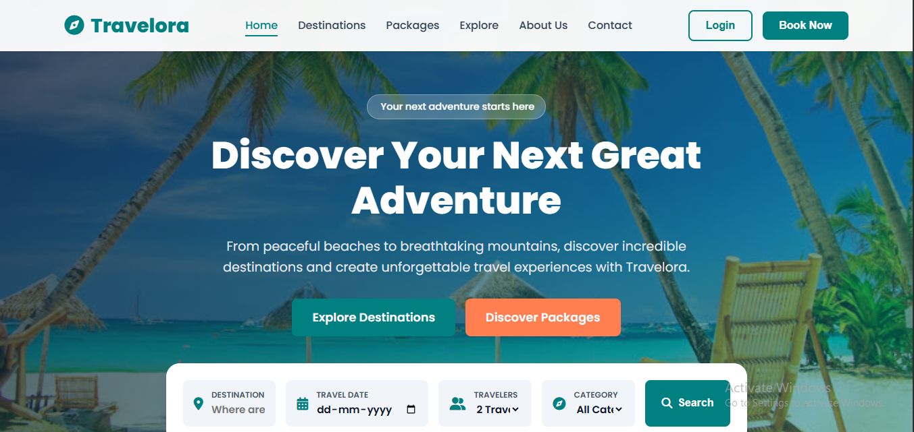
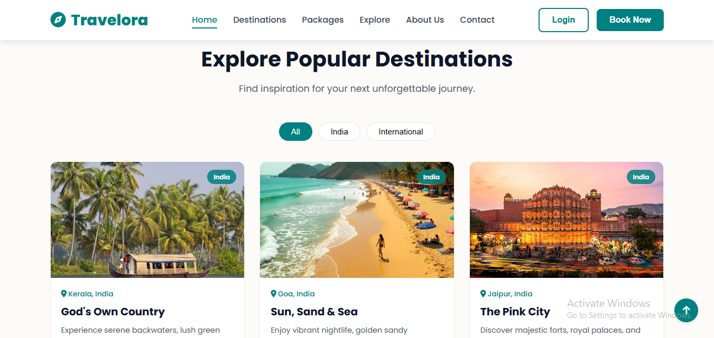
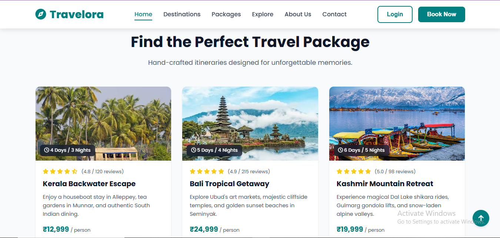
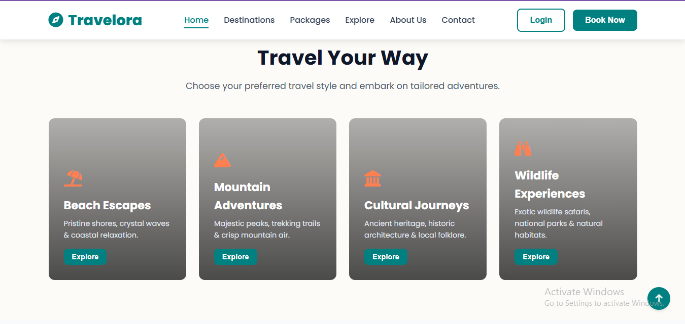
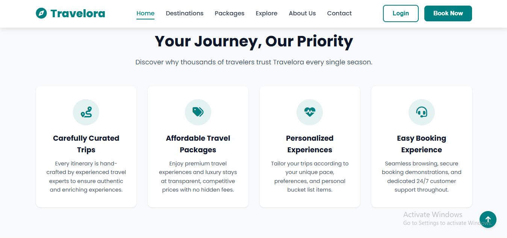
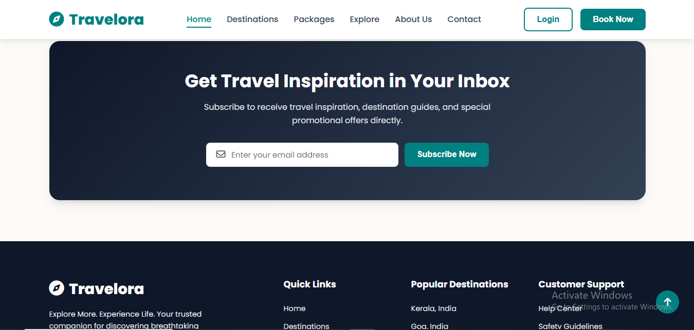

# Travelora - Responsive Travel Booking and Discovery Website

## Internship Details
- Internship Organization: CODTECH IT SOLUTIONS PRIVATE LIMITED
- Domain: Frontend Web Development
- Intern ID: CIS88
- Full Name: ASWINI R
- Email: ashi.07206@gmail.com
- Duration: 30 Days
- No. of Weeks: 4 Weeks
- Project Name: Travelora - Responsive Travel Booking and Discovery Website

## Project Overview
**Travelora** is a fully responsive, modern, and visually striking travel discovery and booking landing page. Designed with a vibrant tropical and oceanic aesthetic, it helps users explore stunning destinations across India and worldwide, browse travel packages, and experience interactive frontend booking demonstrations.

## Project Scope
This project focuses on designing and developing a complete frontend travel website featuring:
- A sticky navigation bar with a mobile hamburger toggle.
- A visually impressive hero section with a tropical background and an interactive search interface.
- A popular destinations grid with category filters (India vs. International).
- Featured travel package cards with ratings, durations, and pricing.
- Travel category exploration cards (Beach Escapes, Mountain Adventures, etc.).
- A "Why Choose Us" features section and special travel offer banners.
- Customer testimonials and a newsletter subscription form with email validation.
- Interactive modal dialogs for demonstration features.
The website is designed to provide a smooth browsing experience across desktop, tablet, and mobile devices.

## Technologies Used
- **HTML5:** For creating the structure and content of the website.
- **CSS3:** For styling, layouts, animations, custom properties, and responsive design.
- **JavaScript:** For interactive elements, destination filtering, search validation, and dynamic functionality.

## Features
- Modern and creative tropical-themed user interface.
- Responsive layout for different screen sizes.
- Interactive navigation bar with smooth scrolling.
- Animated elements, hover effects, and card transitions.
- Dynamic destination category filtering.
- Travel search form and newsletter regex validation.
- Interactive booking and login demonstration modals.
- Floating back-to-top button.

## Project Structure
responsive-landing-page/
│
├── index.html
├── style.css
├── script.js
│
├── assets/
│   ├── images/
│   ├── icons/
│   ├── destinations/
│   └── backgrounds/
│
├── screenshots/
│
└── README.md

## How to Run the Project
1. Clone or download this repository.
2. Open the project folder in Visual Studio Code.
3. Open `index.html` in a web browser.
Alternatively, open the folder in Visual Studio Code and use the Live Server extension.

## Screenshots
Screenshots of the completed website will be included in this repository to demonstrate the project output.
### Home

### Destinations

### Packages

### Explore

### About Us

### Contact

## Conclusion
This project helped me apply my knowledge of HTML, CSS, and JavaScript to develop a responsive and interactive travel booking and discovery website. It also provided practical experience in frontend development, website design, and creating user-friendly interfaces.

Developed as part of the CODTECH IT SOLUTIONS Internship Program.